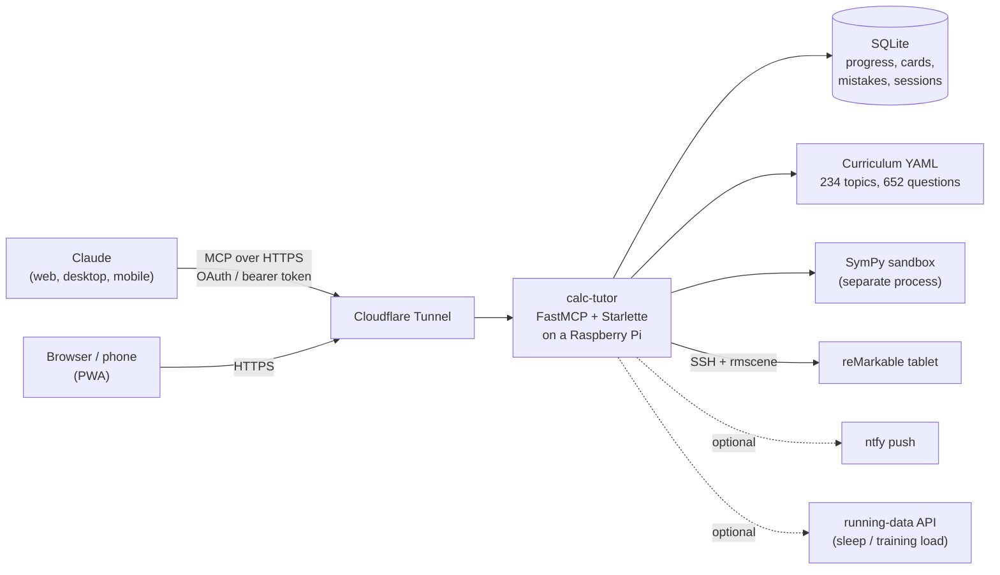

# Calculus Quest: an MCP math tutor that can read your handwriting

An MCP server and companion web app that turn Claude into a structured, honest math tutor. I built it to relearn math for data science (calculus, linear algebra, probability and statistics, discrete math) after years away. General chatbots are poor tutors on their own: they answer too readily, they can get the maths wrong, and they forget everything between sessions. Here the server owns the curriculum, the grading and the memory. Claude does the teaching. Answers are checked symbolically with SymPy rather than by the model, practice is scheduled with spaced repetition (FSRS), and Claude can look at the page I'm writing on in a reMarkable tablet and give feedback on the actual working.

## Architecture



## What's interesting about it

- **Claude reads your handwriting.** `look_at_remarkable` syncs the tablet over SSH, renders the most recently written page with `rmscene` and Pillow, outlines the ink that's new since the last look, and returns it as an image. `push_study_pack` goes the other way: it builds a PDF of attempt-first problems, the assigned textbook pages and a blank recall page, and puts it on the tablet.
- **The model doesn't grade itself.** `check_answer` and `check_step` test symbolic equivalence in a sandboxed SymPy worker with a timeout. New questions Claude writes with `add_question` are saved only if their answer key passes a CAS check. Free-response questions, which can't be checked that way, are marked unverified in the app.
- **Learning-science defaults.** Attempt-first problems before reading, a hint ladder that only unlocks after an attempt, FSRS spaced repetition, a mistake journal that only clears after a later *unaided* correct answer, and three "learning health" numbers: unaided delayed accuracy, hints per problem, and the calibration gap (how often you were sure and wrong).
- **Placement and planning.** A placement test sets your starting point. Sleep and training-load data can turn a day into a review-only day.

## Tools

| Area | Tools |
|---|---|
| Session and planning | `get_student_dashboard`, `get_courses`, `get_curriculum`, `get_textbooks`, `get_topic`, `start_topic`, `complete_topic`, `save_session_notes`, `get_session_history` |
| Practice and grading | `get_quiz`, `check_answer`, `check_step`, `get_hint`, `reveal_solution`, `compute`, `add_question`, `record_grade` |
| Spaced repetition | `get_due_reviews`, `review_flashcard`, `add_flashcard` |
| Mistakes | `log_mistake`, `get_mistakes`, `resolve_mistake` |
| reMarkable | `look_at_remarkable`, `push_study_pack`, `save_recall`, `get_reading_progress` |
| Progress | `get_learning_health`, `get_progress_report`, `get_weekly_summary`, `get_achievements`, `get_fun_fact`, `get_interactive_lessons` |
| Placement | `start_diagnostic`, `answer_diagnostic`, `finish_diagnostic`, `apply_placement`, `get_diagnostic_results` |
| Settings and notifications | `update_settings`, `protect_day`, `send_push` |

## Setup

Requires Python 3.11+ and [uv](https://docs.astral.sh/uv/).

```bash
uv sync
cp .env.example .env      # then fill in CALC_TUTOR_TOKEN and CALC_TUTOR_PUBLIC_URL
```

| Variable | Required | Purpose |
|---|---|---|
| `CALC_TUTOR_TOKEN` | yes | Shared secret for the MCP endpoint and the web app. The server refuses to start without it. |
| `CALC_TUTOR_PUBLIC_URL` | for remote clients | Public HTTPS URL, used by the OAuth custom-connector flow |
| `CALC_TUTOR_HOST`, `CALC_TUTOR_PORT` | no | Bind address (default `127.0.0.1:8830`) |
| `CALC_TUTOR_TZ` | no | Time zone for daily cues and streaks (default `UTC`) |
| `CALC_TUTOR_DB_PATH`, `CALC_TUTOR_LOG_PATH`, `CALC_TUTOR_VAULT_DIR`, `CALC_TUTOR_BOOKS_DIR` | no | Data locations |
| `CALC_TUTOR_REMARKABLE_HOST`, `CALC_TUTOR_REMARKABLE_DIR` | no | SSH alias for the tablet, and a local mirror folder |
| `CALC_TUTOR_NTFY_URL` | no | ntfy topic URL for push notifications |
| `RUNNING_API_URL`, `RUNNING_API_TOKEN` | no | Running-data API for sleep- and training-aware scheduling |

Textbooks: `_books.yaml` lists the readings. Books marked `local` are read from PDFs you supply in `CALC_TUTOR_BOOKS_DIR`. None are included here.

## Run

```bash
uv run python -m calc_tutor
```

This serves MCP at `/mcp` and the web app at `/`. To reach it from Claude on any device, expose it over HTTPS, for example with a Cloudflare Tunnel public hostname pointing at `http://localhost:8830`. Then in Claude open **Settings → Connectors → Add custom connector**, enter `https://<your-host>/mcp`, and enter your token when the authorize page asks for it. `deploy/` has a systemd unit and a nightly SQLite backup script for a Raspberry Pi.

## Example

> **Me:** Look at my reMarkable.
>
> **Claude** *(calls `look_at_remarkable`, gets the page as an image with the new ink outlined)*: You're on Stewart 3.4 #23. Line 2 reads `d/dx sin(x³) = cos(x³)`. You applied the outer derivative but stopped there. What's the derivative of the inside, x³?
>
> **Me:** 3x², so it's 3x² cos(x³).
>
> **Claude** *(calls `check_step` and then `check_answer`)*: Correct, and the step from line 1 to line 2 checks out symbolically. I've logged the first attempt as a chain-rule slip, so it will come back as a "spot the trap" card in a few days.

## Tests

```bash
uv sync --group dev
uv run pytest
```

There are 845 tests: grading and CAS edge cases, the FSRS scheduling engine, curriculum content (every question's answer key must pass its own checker), reMarkable rendering, study-pack generation, and the OAuth handshake.

## License

MIT
